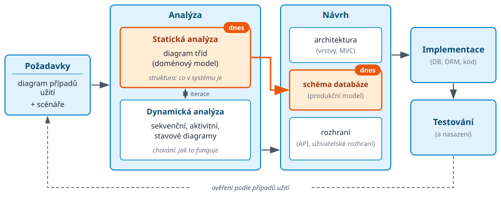

<!-- .slide: class="section" -->

<header>
	<h1>Návrh informačního systému</h1>
	
Od případů užití k datům

</header>

---
<!-- .slide: class="normal centered" -->

# Postup návrhu IS s UML

 <!-- .element: style="width:1450px" -->

Postup je **iterativní** -- jednotlivé kroky se navzájem upřesňují.

---

# Výchozí bod: diagram případů užití

- Co už máme:
	- **Aktéři** -- kdo se systémem pracuje (role uživatelů, okolní systémy)
	- **Případy užití** -- co má systém aktérům umožnit
	- **Scénáře** -- textový popis průběhu jednotlivých případů užití
- Co z něj zatím _nevyplývá_:
	- S jakými **daty** systém pracuje a jak spolu souvisejí
	- Jaké objekty se na případech užití podílejí a jak spolupracují
	- Jak budou data uložena a zpracována
- Odpovědi hledá **analýza** -- statická a dynamická

---

# Statická analýza

- Cíl: popsat **strukturu** modelované reality -- co v systému existuje
- Vychází z případů užití a jejich scénářů
	- Podstatná jména → kandidáti na **třídy** (entity) a jejich **atributy**
	- Slovesa, vazby mezi pojmy → **vztahy** (a jejich kardinalita), operace
	- Zobecnění pojmů → **dědičnost**
- Výsledek: **doménový (konceptuální) model**
	- Diagram tříd UML, případně E-R diagram
	- Nezávislý na konkrétní implementaci (databáze, jazyk)
- Na doménový model navazuje **datové modelování** -- dnešní téma

---

# Příklad: od scénáře ke třídám

Scénář případu užití _Zápis kurzu_:

> **Student** si v období registrace _zapíše_ **kurz**. Každý kurz _vyučuje_ jeden **profesor**, se kterým může _spolupracovat_ několik **asistentů**. Kurz může mít jako **prerekvizitu** jiný kurz.

- Třídy: _Student_, _Kurz_, _Profesor_, _Asistent_
- Vztahy: _je zapsán_ (M:N), _vyučuje_ (1:N), _asistuje_, _prerekvizita_
- Zobecnění: profesor i asistent jsou _zaměstnanci_
- Atributy doplníme ze scénářů a od zadavatele (jméno, login, název kurzu, kredity, …)

---

# Dynamická analýza

- Cíl: popsat **chování** systému -- jak objekty spolupracují při realizaci případů užití
- Prostředky UML:
	- **Sekvenční diagram** -- výměna zpráv mezi objekty v rámci scénáře
	- **Diagram aktivit** -- průběh činností, rozhodování, paralelismus
	- **Stavový diagram** -- životní cyklus objektu (např. stav objednávky)
- Doplňuje doménový model
	- Odhalí chybějící třídy, atributy a vztahy
	- Doplní **operace** tříd
- Statická a dynamická analýza probíhají **iterativně**

---

# Od doménového modelu k implementaci

- Doménový model je **konceptuální** -- popisuje realitu, ne implementaci
- V jednotlivých vrstvách IS z něj vznikají různé **reprezentace dat**:
	- Databázová vrstva -- **schéma databáze** (produkční model, ORM)
	- Business vrstva -- **objekty** v paměti aplikace a jejich operace
	- Prezentační vrstva -- **vizualizace** (formuláře, tabulky) a **serializace** (webová API)
- Všechny vycházejí ze stejného modelu → potřebujeme umět:
	- Data _obecně popsat_ (struktury, kolekce, vztahy)
	- Popis _transformovat_ mezi různými modely
