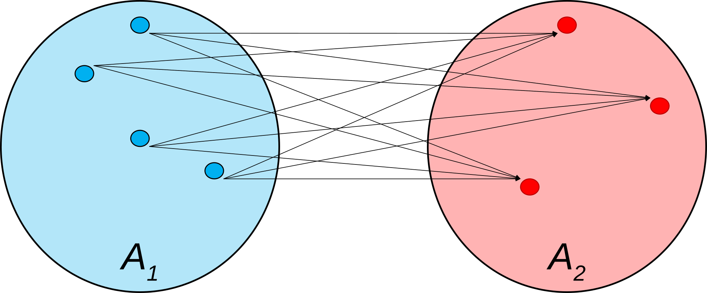
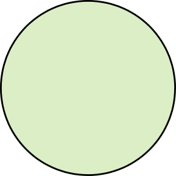
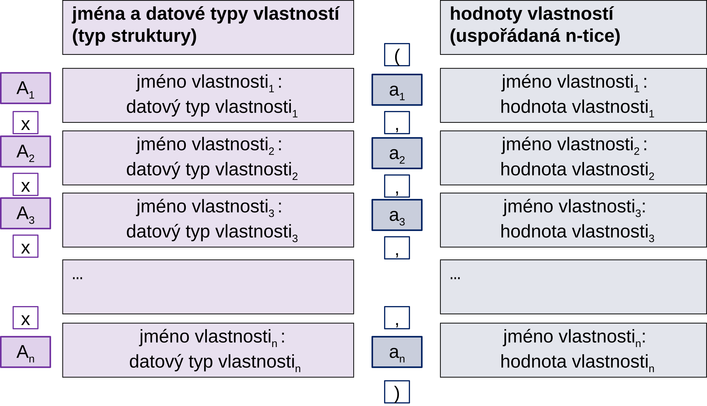
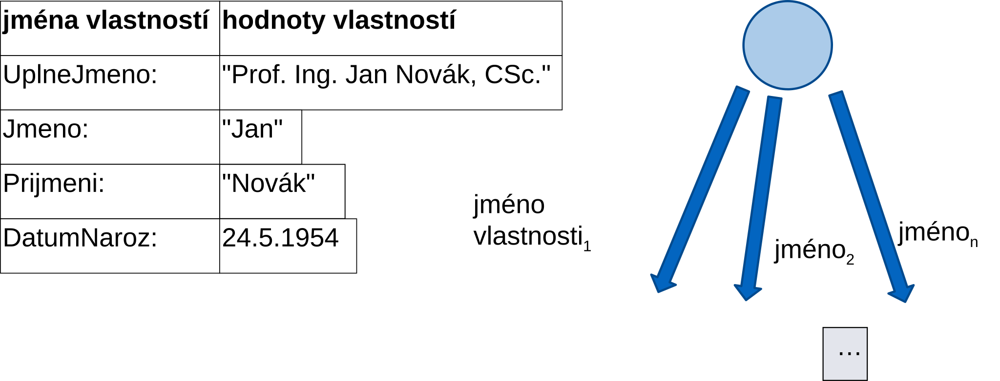
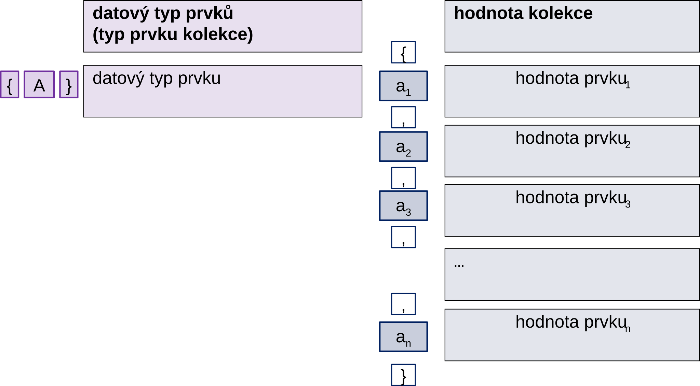
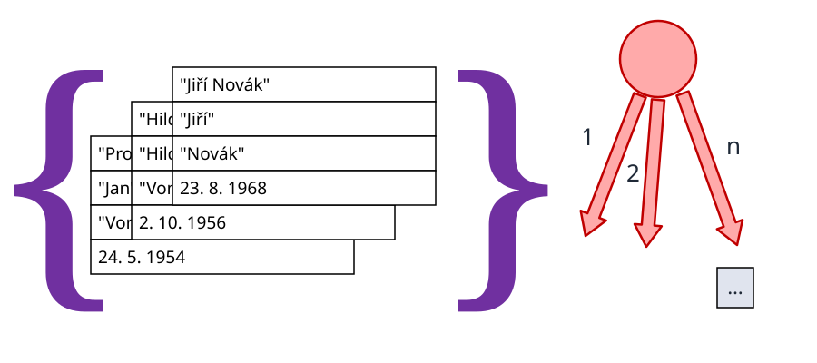
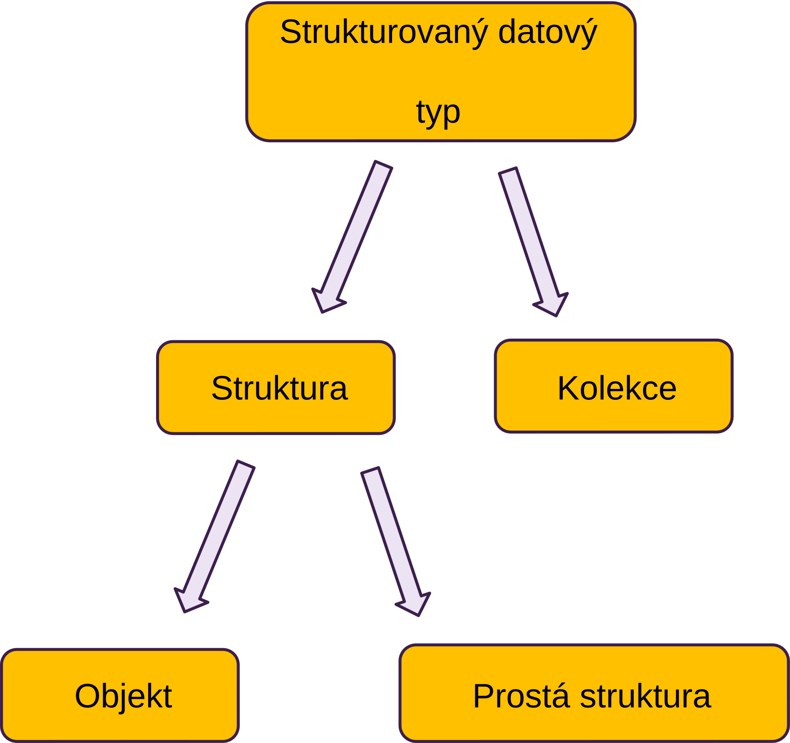
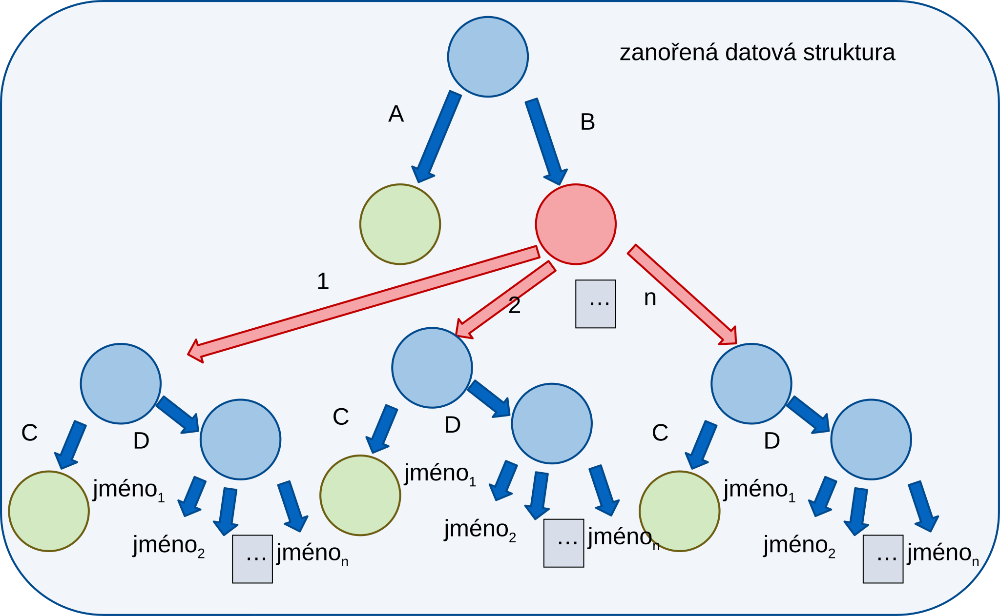

<!-- .slide: class="section" -->

<header>
	<h1>Strukturovaná data</h1>
	<p>Jak vyrobit z jednoduchých údajů složité?</p>
</header>

---
<!-- .slide: class="normal centered" -->

# Kartézský součin $A_1 \times A_2$

 <!-- .element: style="height:550px" -->

Výsledkem je **množina dvojic** -- celkem $4 \times 3=12$ dvojic.

---

# Kartézský součin
- **Uspořádaná n-tice** $(a_1, a_2, \dots, a_n)$
- **Kartézský součin množin** $A_1 \times A_2 \times \dots \times A_n$ je množina všech uspořádaných n-tic takových, že $a_1 \in A_1, a_2 \in A_2, \dots, a_n \in A_n$
- Podstatné je, že $i$-tá složka uspořádané n-tice je prvkem množiny $A_i$, tj. té, která jí indexem odpovídá -- na pořadí složek záleží

---

<!-- .slide: class="section" -->
<header>
	<h1>Struktura a kolekce</h1>
</header>

---

# Základní typy

 <!-- .element: style="float: right; height: 100px" -->

- **Datový typ** je _množina_ všech přípustných hodnot (doména)
- **Hodnota** je _prvek_ této množiny, např. $42 \in \textit{integer}$, $\texttt{"Novák"} \in \textit{string}$
- Složitější typy pak vytváříme operacemi nad těmito množinami (např. kartézským součinem)
- Základní nestrukturované datové typy:
	- Celočíselné
	- Reálná čísla
	- Znaky / řetězce
	- Datum / čas
	- Výčtové typy 
	apod.

---

# Strukturované datové typy

- Strukturovaný datový typ = datová struktura = _metadata_ 
	- Jak z jednodušších datových typů (ať už základních nebo i jednodušších strukturovaných) budovat složitější. 
- Existují základní dva způsoby, jak strukturované datové typy vytvářet:
	- _struktura_ a
	- _kolekce_.
- Vše je definováno předem, před vznikem hodnoty

---

# Struktura
- Strukturované hodnoty vytvářené:
	- **Pevným počtem** dílčích hodnot obecně **různých** typů
	- Tedy uspořádané n-tice, které jsou prvky kartézského součinu množin dílčích datových typů
	- Hodnoty jsou pojmenované, tzn. přistupuje se k nim přes jejich unikátní jméno
	- Pojmenování složek tak nahrazuje jejich pořadí v n-tici, **není součástí dat**
- Jako synonymum pro uspořádanou n-tici (tedy hodnotu) je velmi často užíván termín _struktura_ nebo _záznam_. Jako synonymum pro kartézský součin (tedy datový typ) budeme často používat _typ struktura_ nebo _typ záznam_.

---

<!-- .slide: class="normal centered" -->

# Schéma struktury

 <!-- .element: style="height:700px" -->


---

# Příklad datového typu struktura

```
structure FyzOsoba
   properties
      UplneJmeno: string
      Jmeno:      string
      Prijmeni:   string
      DatumNaroz: date
end structure
```

Zápis ve formě kartézského součinu:

$\textit{FyzOsoba} = \textit{string} \times \textit{string} \times \textit{string} \times \textit{date}$

---

# Hodnota struktury

Uspořádaná čtveřice:

<div class="small">

$(\texttt{"Prof. Ing. Jan Novák, CSc."}, \texttt{"Jan"}, \texttt{"Novák"}, \texttt{24.5.1954}) \in \textit{FyzOsoba}$

</div>

 <!-- .element: style="height:500px" -->


---

# Kolekce
- **Kolekce** (synonyma jsou _posloupnost_, _seznam_) je, na rozdíl od struktur, tvořena
	- **Předem neomezeným počtem** hodnot **stejného** datového typu.

---

# Kolekce
- Množina obsahuje obvykle každý prvek pouze jednou. Pokud je povoleno, aby daný prvek byl v množině vícekrát, mluvíme o **multimnožině** 
- Tradiční seznam je _uspořádanou multimnožinou_
- Obecně lze vytvářet kolekce s prvky libovolných datových typů. 
- Časté omezení je vytvářet pouze kolekce s prvky datového typu struktura 

---

<!-- .slide: class="normal centered" -->

# Schéma kolekce

 <!-- .element: style="height:700px" -->

---

# Příklad datového typu kolekce struktur

```
collection FyzickeOsoby of
   structure FyzOsoba
      properties
         UplneJmeno: string
         Jmeno:      string
         Prijmeni:   string
         DatumNaroz: date
   end structure
```

Datový typ: množina všech podmnožin (potenční množina)

$\textit{FyzickeOsoby} = \\{ M \mid M \subseteq \textit{FyzOsoba} \\} = \mathcal{P}(FyzOsoba)$

---

# Hodnota kolekce

<div class="small">

$\\{o_1, o_2, \dots, o_n\\} \in \textit{FyzickeOsoby}$, kde $o_i \in \textit{FyzOsoba}$

</div>

 <!-- .element: style="height:700px" -->

---

# Agregáty
- Vlastnostmi kolekce jsou nejčastěji **agregáty** (agregované hodnoty), což jsou hodnoty statisticky popisující prvky kolekce nejčastěji číselných hodnot. 
	- počet prvků,
	- maximum, 
	- minimum, 
	- součet hodnot, 
	- průměr atd.

---

# Objekt a prostá struktura
- Objekt je **struktura s identifikací**.
- Každému objektu v systému přiřazena jednoznačná identifikace nazývaná **OID** (_object identification_).
- Objekt je tedy struktura, jejíž systémovou a obvykle první vlastností je OID. Hodnotu OID generuje databázový systém při vzniku objektu a po celou dobu činnosti ji nemění.
- Tím, že má objekt OID, je _identifikovatelný_ a tudíž i _odkazovatelný_. Má to za následek, že může figurovat jako člen ve vztazích. To struktura bez identifikace nemůže. Takovou strukturu bez OID budeme nadále nazývat **prostou strukturou**.

---

<!-- .slide: class="normal centered" -->

# Strukturované datové typy

 <!-- .element: style="height:700px" -->

---

# Zanořené kolekce a struktury
- Obecně lze struktury a kolekce libovolně vzájemně vnořovat

```
structure ZANORENA
   properties
      A: integer
      B: collection of structure
            properties
               C: integer
               D: structure
                     …
                  end structure
         end structure
end structure
```

---

<!-- .slide: class="normal centered" -->

# Graf hodnoty zanořených typů

 <!-- .element: style="height:700px" -->


