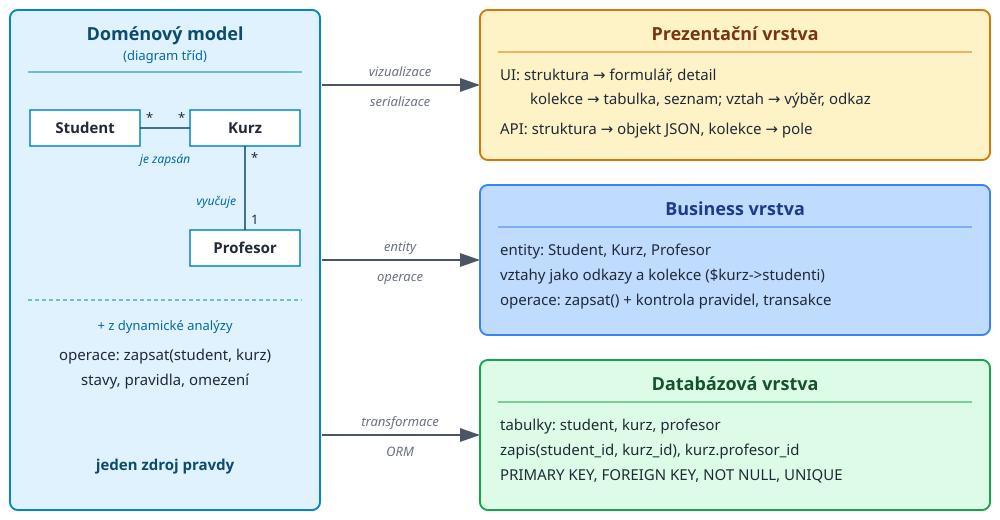

<!-- .slide: class="section" -->

<header>
	<h1>Od modelu k aplikaci</h1>
	
Jak se model promítne do vrstev IS

</header>

---
<!-- .slide: class="normal centered" -->

# Jeden model -- více reprezentací

 <!-- .element: style="width:1150px" -->

---

# Příklad: kurz napříč vrstvami

| Vrstva | Kurz | Vztah _je zapsán_ (M:N) |
|---|---|---|
| **Doménový model** | třída _Kurz_ | asociace Student -- Kurz |
| **Databáze** | tabulka `kurz` | vazební tabulka `zapis` |
| **Business** | objekt `Kurz`, operace | kolekce `$kurz->studenti`, _zapsat()_ |
| **API** | objekt JSON | odkaz `/api/kurzy/42/studenti` |
| **Uživatelské rozhraní** | detail, formulář | seznam studentů, tlačítko _Zapsat_ |

---

# Závěr

- Ze struktur, kolekcí, základních typů a odkazů lze sestavit konceptuální i produkční modely
- Konceptuální model → **transformace** → produkční model (ručně nebo ORM)
- Doménový model určuje podobu všech vrstev IS:
	- schéma databáze, entity a operace business vrstvy, uživatelské rozhraní i API
- Co dále?
	- **Vizualizace** (2D) a **serializace** (1D) dat
	- Webová API, klientská část IS
	- Integrita, konzistence a transakce
