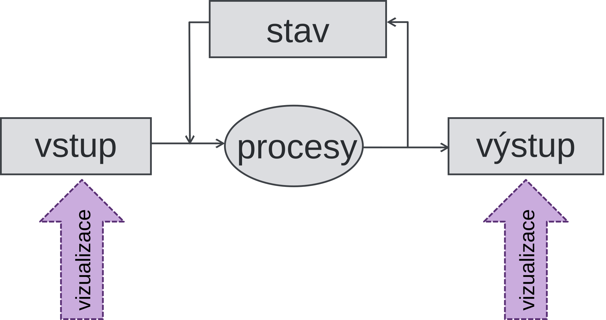
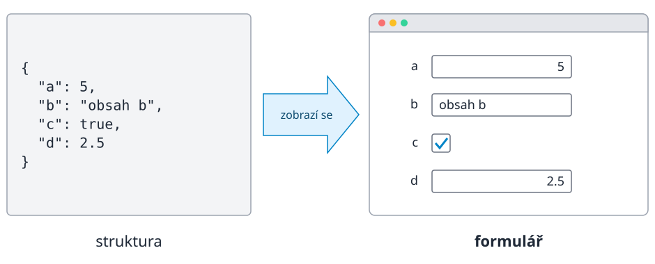
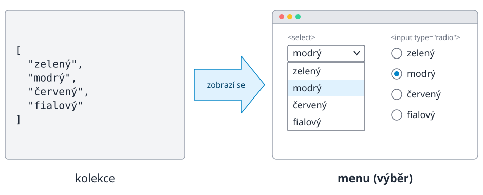
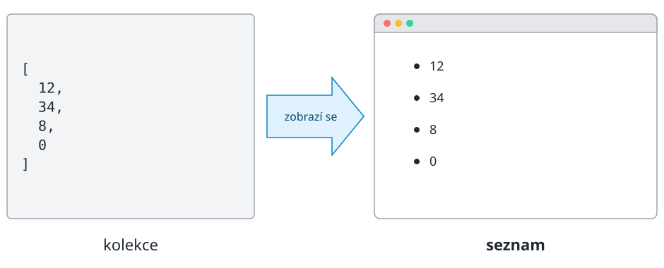
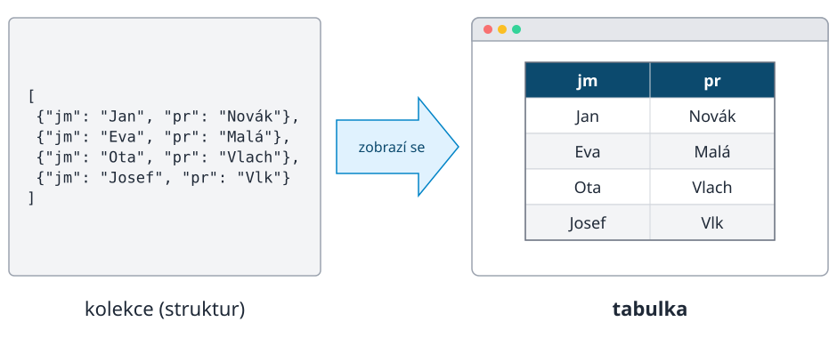

# Vizualizace a serializace
- Data v IS – jednoduché hodnoty, struktury a kolekce reprezentované pomocí vhodných modelů
- **Vizualizace**
	- 2D reprezentace dat pro uživatele
	- HTML, CSS, generování HTML z dat
	- Pokročilé: JavaScript na straně klienta (p09), XSLT (p08)
- **Serializace**
	- 1D reprezentace – sériová forma (řetězec)
	- JSON, XML, YAML, formuláře a další specializované formáty

---

<!-- .slide: class="normal centered" -->

# Vizualizace v informačním systému

 <!-- .element: style="height: 700px" -->

---

# Zobrazení struktury

 <!-- .element: style="width:1100px" -->

- Počet položek formuláře není závislý na hodnotě struktury
- Typ položky odpovídá typu hodnoty (text, číslo, `checkbox`, datum, …)

---

# Zobrazení kolekce jako menu

 <!-- .element: style="width:1100px" -->

- Počet položek menu se mění s hodnotou kolekce
- V HTML např. `<select>`, `<input type="radio">`, `<input type="checkbox">` (výběr více hodnot)

---

# Zobrazení kolekce jako seznamu

 <!-- .element: style="width:1100px" -->

- Počet řádků seznamu se mění s hodnotou kolekce
- V HTML např. `<ul>`, `<ol>`, `<li>`, …

---

# Zobrazení kolekce jako tabulky

 <!-- .element: style="width:1100px" -->

- Počet řádků tabulky se mění s hodnotou kolekce
- Nejčastější variantou je tabulka zobrazující kolekci struktur (relaci)
- Velké kolekce nezobrazujeme celé – **stránkování**, řazení, filtrování

---

# Generování HTML z dat

- Kolekce se zobrazí průchodem v cyklu – typicky v **šabloně** (_template_)
	- PHP, Latte, Twig, Blade, …, případně v prohlížeči z JSON (p09)

```php
<table>
  <tr><th>Jméno</th><th>Příjmení</th></tr>
  <?php foreach ($osoby as $o): ?>
  <tr><td><?= htmlspecialchars($o['jm']) ?></td>
      <td><?= htmlspecialchars($o['pr']) ?></td></tr>
  <?php endforeach; ?>
</table>
```

- Data je nutné **escapovat** – jinak hrozí _Cross-Site Scripting_ (XSS)
	- Šablonovací systémy escapují automaticky

---

# Vizuální prezentace

- HTML kód generovaný serverem by měl popisovat pouze obsah výsledného dokumentu a jeho strukturu
	- Tabulky, seznamy, formuláře, atd.
- Vizuální prezentace musí být definována zvlášť
	- Často spravována nezávisle
	- Různá zařízení (desktop, mobil, tisk, …) – dnes typicky jediný **responzivní** styl
	- Chceme udržet serverový kód co nejjednodušší
- Jak definovat vizuální prezentaci odděleně?
	- _Cascading Style Sheets_ – CSS

---

# Cascading Style Sheets

- Samostatná definice vzhledu – stylový předpis (_style sheet_)
	- Sada CSS pravidel
- Každé pravidlo definuje vlastnosti nějaké množiny HTML elementů
	- Selektor pravidla – vybírá množinu HTML elementů
	- Deklarace vlastností – definuje konkrétní vizuální vlastnosti
- Jedno pravidlo se může týkat většího množství elementů
- Vzhled elementů může být výsledkem aplikace většího množství pravidel
- Moderní CSS: rozvržení pomocí _Flexbox_ a _Grid_, _media queries_ pro responzivní design, proměnné (_custom properties_)

---

# Více o CSS

- Jednoduchý příklad
	- https://github.com/DIFS-Teaching/basic-demos/blob/master/php-forms-pdo/style.css
- Přednášky ITW
	- [Kaskádové styly](https://gitshow.net/https/difs-teaching.github.io/slides/itw/p03_css)
	- [Responzivní design](https://gitshow.net/https/difs-teaching.github.io/slides/itw/p07_responsive)

---

# CSS Frameworky

- Hotová CSS řešení pokrývající nejčastější prvky uživatelského rozhraní
- Využití nejčastěji pomocí přidání různých tříd HTML elementům (standardní atribut `class`)
- Vhodné pro rychlý návrh aplikace
	- Avšak značná část specifikace vzhledu se přesouvá do HTML, což úplně nechceme
	- Možnost kombinovat s vlastními CSS předpisy a problém alespoň částečně eliminovat

---

# CSS Frameworky (II)

- **Komponentové** frameworky – hotové prvky (tlačítka, karty, navigace, …)
	- Např. _Bootstrap_, _Bulma_
- **Utility-first** frameworky – jedna třída = jedna vlastnost
	- Např. _Tailwind CSS_: `<button class="px-4 py-2 rounded bg-blue-600 text-white">`
	- Vzhled je zcela v HTML; zvládnutelné díky komponentám/šablonám, které se opakovaně používají

