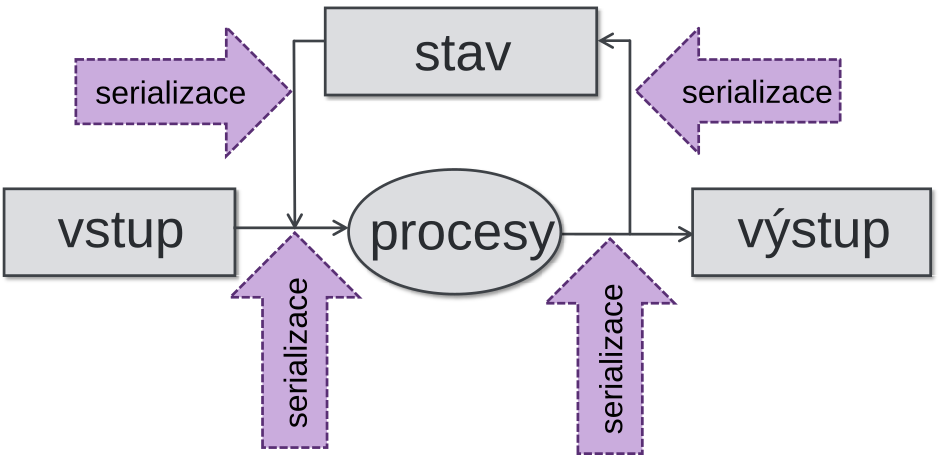
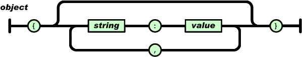
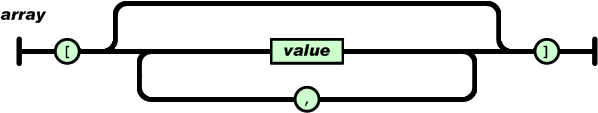
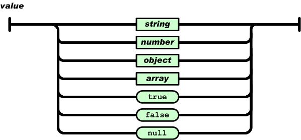
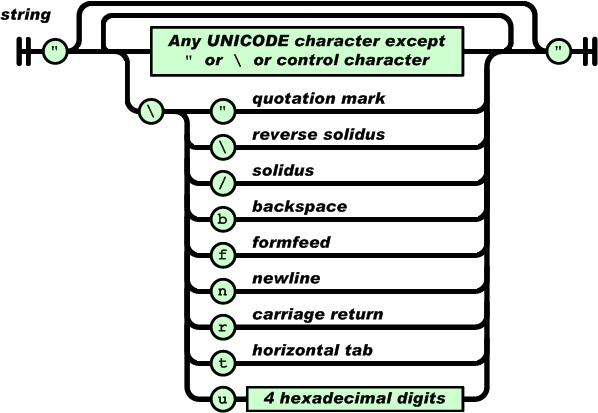
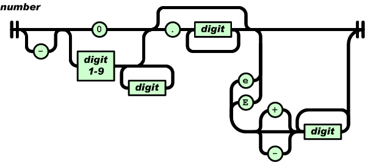

<!-- .slide: class="section" -->

<header>
   <h1>Serializace</h1>
   <p>Řetězcová reprezentace strukturovaných dat</p>
</header>

---

# Serializace

- **Serializace** (_marshalling_) je převod datových struktur nebo stavu objektů do formátu (posloupnosti znaků či bajtů), který lze
	- uložit (soubor, databáze, cache) nebo
	- přenést po síti
- **Deserializace** (_unmarshalling_) – rekonstrukce hodnoty z této reprezentace (vytvoření sémanticky ekvivalentního klonu původní datové struktury)
- Serializuje se pouze stav (hodnoty), nikoli chování (metody) – to musí znát přijímající strana

---

# Serializace v informačním systému

<!-- .slide: class="normal centered" -->

 <!-- .element: style="height: 700px" -->

---

# Syntaxe serializačních formátů
- Formálněji řečeno je serializace vyjádřením hodnoty v nějakém **formálním jazyce**
- Hodnoty struktury a kolekce mají tvar
	- hodnota typu struktura = uspořádaná n-tice $(a_1, a_2, \dots, a_n)$
	- hodnota typu kolekce = (uspořádaná) množina $\\{b_1, b_2, \dots, b_n\\}$
- Hodnoty mohou být libovolně zanořené – zápis tvoří vnořené závorkové výrazy tvaru $a^n \dots b^n$
	- Takový jazyk není regulární, musí být minimálně **bezkontextový**
- Vyhovuje libovolný jazyk se zápisem literálů strukturovaných hodnot (např. JavaScript → JSON), případně speciální značkovací jazyk (XML)

---

# Úskalí serializace

- **Odkazy** mezi objekty (vztahy)
	- Sdílené objekty a cykly nelze přímo vyjádřit stromovou strukturou
	- Nahrazují se identifikátory nebo odkazy (URL) – viz vztahy v datovém modelu (p05)
- Typy – formát často nezná všechny typy jazyka (datum, třída objektu, …)
- Verzování – struktura dat se v čase mění, starší data a klienti musí zůstat použitelní
- **Bezpečnost** – nativní serializace jazyků (`unserialize()` v PHP, `Serializable` v Javě, `pickle` v Pythonu) může při deserializaci nedůvěryhodných dat vytvořit libovolné objekty a spustit kód
	- Pro výměnu dat proto používáme jazykově nezávislé formáty (JSON, XML, …)

---

# Serializační formáty

- Často proprietární formáty jednotlivých aplikací
	- Závislost na architektuře (např. dump paměti)
	- Nemožnost sdílet existující nástroje (parser, …)
- 1984 _ASN.1_ (ITU-T) – dodnes např. certifikáty X.509
- 1987 _External Data Representation_ (XDR) – Sun Microsystems
- 1998 XML 1.0 (W3C)
- 2001 JSON (D. Crockford), standardizován 2006 (RFC 4627), dnes RFC 8259 a ECMA-404
- 2001 YAML, aktuální verze 1.2 (2009)
- 2008 _Protocol Buffers_ (Google)
- mnoho dalších

---

# Přehled formátů

|  | Textové | Binární |
|---|---|---|
| **Bez schématu** | JSON, YAML, CSV | MessagePack, CBOR |
| **Se schématem** | XML + XSD, JSON + JSON Schema | Protocol Buffers, Avro |

- Textové formáty jsou čitelné pro člověka, binární kompaktnější a rychlejší (např. _gRPC_ používá Protocol Buffers)
- Schéma umožňuje validaci dat a generování kódu
- **CSV** – v IS velmi časté pro import a export tabulkových dat
	- Žádné datové typy, nejednotný oddělovač (`,` vs. `;` v české verzi Excelu), kódování znaků

---

# JSON
- **J**ava**S**cript **O**bject **N**otation
- Vychází ze syntaxe pro zápis literálů v JavaScriptu (ECMA-262, 1999)
	- Navržen pro přenos dat mezi serverem a prohlížečem
- Dnes samostatný standard nezávislý na JavaScriptu (RFC 8259)
	- Podpora na všech hlavních serverových i klientských platformách
	- MIME typ `application/json`, kódování UTF-8
- Dominantní formát webových API (p07)
- Původně se v prohlížeči zpracovával funkcí `eval()` – **bezpečnostní riziko**, dnes výhradně `JSON.parse()`

---

# Struktura v JSON

 <!-- .element: style="width:80%" -->

Je serializací **neuspořádané struktury** (objekt) – pořadí klíčů není významné, klíče by měly být jedinečné

---

# Kolekce v JSON

 <!-- .element: style="width:80%" -->

Je serializací **uspořádané kolekce** – seznamu (pole)

---

# Základní typy v JSON

 <!-- .element: style="width:80%" -->

---

# Textové řetězce v JSON

 <!-- .element: style="height:700px" -->

---

# Čísla v JSON

 <!-- .element: style="height:700px" -->

---

# Příklad JSON

```json
{
   "firstName": "John",
   "lastName": "Smith",
   "address": {
      "streetAddress": "21 2. street",
      "city": "New York",
      "state": "NY",
      "postalCode": "10021"
   },
   "phoneNumbers": ["212 555-1234", "646 555-4567"]
}
```

- PSČ, telefonní čísla, rodná čísla apod. zapisujeme jako řetězec – nejde o čísla, se kterými se počítá (a číslo by ztratilo např. úvodní nuly)

---

# Datové typy v JSON – úskalí

- Pouze objekt, pole, řetězec, číslo, `true`/`false` a `null`
- **Chybí datum a čas** – zapisuje se jako řetězec dle ISO 8601: `"2026-11-03T10:15:00+01:00"`
- Čísla nerozlišují celá a desetinná, rozsah není omezen
	- JavaScript reprezentuje celá čísla přesně jen do $2^{53}$ – dlouhá ID raději jako řetězec
	- Peněžní částky – pozor na zaokrouhlovací chyby (raději haléře nebo řetězec)
- Binární data – kódování Base64 do řetězce
- Nelze psát komentáře ani čárku za posledním prvkem
	- Pro konfigurační soubory se proto spíše používá YAML, TOML apod.

---

# Práce s JSON

- JavaScript: `JSON.stringify(objekt)`, `JSON.parse(retezec)`
- PHP:

```php
$json = json_encode($data, JSON_UNESCAPED_UNICODE);  // č místo \u010d
$obj = json_decode($json);        // objekty: $obj->address->city
$arr = json_decode($json, true);  // pole: $arr['address']['city']
$arr = json_decode($json, true, flags: JSON_THROW_ON_ERROR);
```

- Bez `JSON_THROW_ON_ERROR` vrací `json_decode()` při chybě `null` – nelze odlišit od platné hodnoty `null`
- Formální popis struktury dokumentu: **JSON Schema** – validace dat, popis webových API (OpenAPI, p07)

---

# YAML
- _YAML Ain't Markup Language_
- Zápis zaměřený na čitelnost pro člověka; od verze 1.2 nadmnožina JSON
- Strukturování dat **odsazením** (pouze mezery, ne tabulátory)
- Podpora odkazů – kotva `&id` a odkaz `*id`
	- Lze vyjádřit i sdílené hodnoty, tedy obecně graf, nejen strom
- Dnes hlavně pro **konfigurace**: Docker Compose, Kubernetes, GitHub Actions, OpenAPI, …

---

# YAML – úskalí

- **Implicitní typování** – typ hodnoty se odvozuje z jejího zápisu, ne ze schématu

```yaml
zeme: [CZ, SK, NO]      # → ["CZ", "SK", false]
verze: 1.10             # → 1.1 (číslo)
cas: 22:30              # → 1350 (YAML 1.1: šedesátková soustava)
```

- YAML 1.1 považuje za logické hodnoty i `yes`/`no`, `on`/`off`, `y`/`n` – kód Norska `NO` je `false`
	- YAML 1.2 to omezuje na `true`/`false`, řada knihoven však stále implementuje 1.1
	- Řešení: textové hodnoty dávat do uvozovek (`"NO"`, `"1.10"`)
- Načítání nedůvěryhodného YAML může vytvářet libovolné objekty – používat bezpečné načítání (např. `yaml.safe_load()`)

---

# YAML příklad

```yaml
invoice: 34843
date   : 2001-01-23
bill-to: &id001
    given  : Chris
    family : Dumars
    address:
        lines: 458 Walkman Dr.
        city    : Royal Oak
        state   : MI
        postal  : 48046
ship-to: *id001
```

- `&id001` – kotva, `*id001` – odkaz: `ship-to` je tatáž hodnota jako `bill-to`

---

# YAML příklad

```yaml
product:
    - sku         : BL394D
      quantity    : 4
      description : Basketball
      price       : 450.00
    - sku         : BL4438H
      quantity    : 1
      description : Super Hoop
      price       : 2392.00
tax  : 251.42
total: 4443.52
comments: >
    Late afternoon is best.
    Backup contact is Nancy
    Billsmer @ 338-4338.
```

- `-` uvozuje prvek kolekce, `>` víceřádkový text (konce řádků se nahradí mezerami)

---

# XML
- e**X**tensible **M**arkup **L**anguage – W3C, 1998
- Vychází ze standardu _SGML_, původně jazyk pro tvorbu dokumentů
- Hierarchické zanořování **elementů** s _atributy_, jeden kořenový element
	- XML nedefinuje jména ani význam elementů – určuje je konkrétní aplikace
- Rozsáhlý ekosystém navazujících technologií (p08)
	- Schémata a validace (DTD, XSD), dotazování (XPath), transformace (XSLT), objektová reprezentace (DOM)
- Ve své době první kandidát pro reprezentaci dat
	- Avšak v mnoha situacích poměrně těžkopádný

---

# Příklad XML

```json
{
   "firstName":"John",
   "lastName":"Smith",
   "address":{
      "streetAddress":"21 2. street",
      "city":"New York",
      "state":"NY",
      "postalCode":"10021"
   },
   "phoneNumbers":["212 555-1234", "646 555-4567"]
}
```
<!-- .element: class="col"  -->

```xml [1-15|1|2,15|11,14|1-15]
<?xml version="1.0" encoding="UTF-8"?>
<person>
   <address>
      <city>New York</city>
      <postalCode>10021</postalCode>
      <state>NY</state>
      <streetAddress>21 2. street</streetAddress>
   </address>
   <firstName>John</firstName>
   <lastName>Smith</lastName>
   <phoneNumbers>
      <item>212 555-1234</item>
      <item>646 555-4567</item>
   </phoneNumbers>
</person>
```
<!-- .element: class="col"  -->


- Záhlaví XML není nutné pro kódování UTF-8
- Navíc kořenový element a elementy pro prvky kolekce
- Alternativní zápisy (atributy místo elementů) a další detaily v p08

---

# JSON nebo XML?

- **JSON**
	- Dominantní formát webových API (REST, GraphQL)
	- Snadné čtení i zápis, přímé mapování na objekty a pole jazyka
- **XML**
	- Dokumentově orientovaná data (text proložený značkami)
	- Zavedené standardy pro výměnu dat s přesně definovaným schématem
		- E-government: datové schránky, elektronická podání finanční správě
		- Elektronická fakturace (ISDOC, UBL), SOAP služby v podnikové integraci
		- Formáty dokumentů: DOCX, ODT, SVG, RSS/Atom
- YAML – konfigurace, CSV – tabulková data pro import a export
- Často je volba zbytečně subjektivní :-)

---

<!-- .slide: class="section" -->
<header>
	<h1>Omezené serializační formáty</h1>
	<p>Pro speciální použití</p>
</header>

---

# Omezené serializační formáty
- Omezují hloubku zanoření a typy položek strukturovaných hodnot
	- Typicky jedna úroveň: struktura textových hodnot, případně s opakovanými položkami
	- K jejich popisu proto stačí **regulární** jazyk
- Použití například pro předávání obsahu formulářů v HTML protokolem HTTP
	- `application/x-www-form-urlencoded`
	- `multipart/form-data`

---

# application/x-www-form-urlencoded
- Serializace struktury s položkami textového typu
	- Zaškrtávací pole (`checkbox`) se odešle, jen pokud je zaškrtnuté – „booleovská“ hodnota
- Dvojice `jméno=hodnota` oddělené znakem `&`
- Mezery se převádějí na `+`, ostatní znaky kromě alfanumerických a `*-._` na `%hh`, kde `hh` je hexadecimální hodnota bajtu v kódování UTF-8
- Odešle se i tlačítko Submit, pokud má atribut `name` – lze rozlišit, kterým tlačítkem byl formulář odeslán

---

# application/x-www-form-urlencoded
- Uživatel vyplní formulář s poli `Jmeno`, `Chut` a zaškrtávacími poli `Posyp[]`:

```text
Jmeno=Hru%C5%A1ka&Chut=Vanilkova&Posyp%5B%5D=orechy&Posyp%5B%5D=cokolada
```

- `š` je v UTF-8 dvojice bajtů `C5 A1`, `[]` → `%5B%5D`
- Opakovaná položka = jednoduchá kolekce
	- PHP vyžaduje jméno končící `[]`, `$_POST['Posyp']` je pak pole
- Používá se pro přenos hodnot z prvku `<form>` jazyka HTML
	- Metoda GET: v URL za znakem `?`, metoda POST: v těle požadavku
	- V PHP jsou hodnoty v `$_GET` / `$_POST` již dekódované

---

# multipart/form-data
- Serializace struktury s textovými položkami **i soubory**
- Každé pole má vlastní oddíl s hlavičkami, oddíly jsou odděleny oddělovačem (_boundary_) zvoleným tak, aby nekolidoval s odesílanými daty
- Neprovádí se žádné kódování hodnot – je možné přenášet **binární data** (RFC 7578)
- Používá se pro přenos hodnot z prvku `<form>` jazyka HTML
	- Nutno specifikovat pomocí atributu `enctype`, pouze metoda POST
	- Potřebné pro přenos souborů `<input type="file">`

---

# Příklad formuláře s MIME typem

```html
<form action="upload.php" method="post"
				enctype="multipart/form-data">
    <label for="fileToUpload">Select file to upload:</label>
    <input type="file" name="fileToUpload" id="fileToUpload">
    <input type="submit" value="Upload Image" name="submit">
</form>
```

<div class="small">

- PHP automaticky převezme uploadovaný soubor a uloží do dočasného souboru na serveru
- Údaje jsou v `$_FILES['fileToUpload'][…]`
	- `name` – jméno originálního souboru, `tmp_name` – jméno dočasného souboru
	- `size`, `error` – velikost, kód chyby
	- `type` – MIME typ **zadaný klientem – nelze mu věřit**
- Uložení `move_uploaded_file()`, typ ověřit podle obsahu (např. `finfo_file()`)

</div>

---

# Příklad serializovaného formuláře

```http
-‑7d627e30307c4
Content-Disposition: form-data; name="submit"

Upload Image
-‑7d627e30307c4
Content-Disposition: form-data; name="fileToUpload"; filename="a.jpg"
Content-Type: image/jpeg

…………
-‑7d627e30307c4-‑
```

- Hlavička požadavku: `Content-Type: multipart/form-data; boundary=7d627e30307c4`
- Oddělovač v těle je `-‑` + _boundary_, konec dat `-‑` + _boundary_ + `-‑`

---

# Formuláře vs. JSON

<div class="small">

- Klientské aplikace v JavaScriptu často odesílají data jako JSON

</div>


```js
fetch('/api/osoby', {
    method: 'POST',
    headers: { 'Content-Type': 'application/json' },
    body: JSON.stringify({ jm: 'Jan', pr: 'Novák' })
});
```

<div class="small">

- PHP plní `$_POST` **pouze** pro `application/x-www-form-urlencoded` a `multipart/form-data`
- Tělo s JSON je nutné načíst a dekódovat ručně:

</div>

```php
$body = file_get_contents('php://input');
$data = json_decode($body, true, flags: JSON_THROW_ON_ERROR);
```

<div class="small">

- Frameworky to obvykle řeší automaticky

</div>
