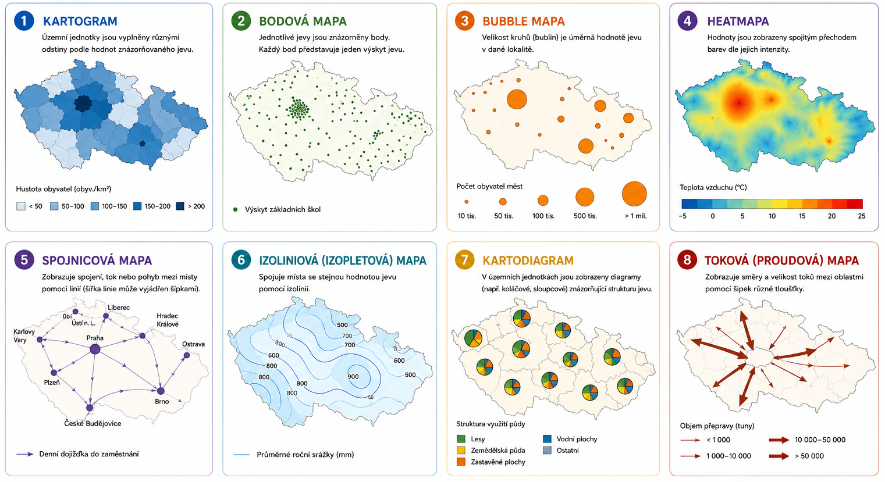
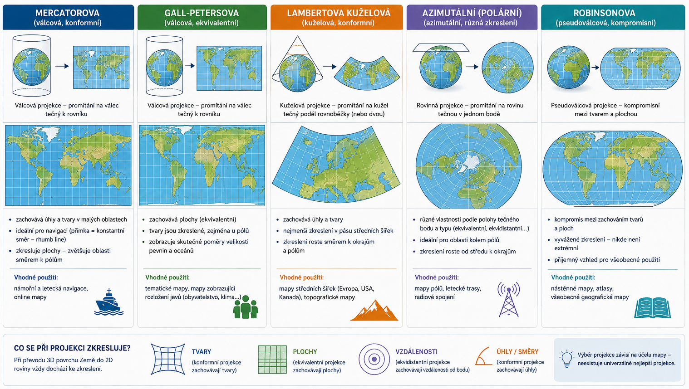

<!-- .slide: class="section" -->

<header>
    <h1>3. Prezentace</h1>
    
</header>

---

<!-- .slide: class="quote" -->

# Cíl

> Provést projekci dat do ***tematické mapy***.

---

# Tematická mapa

- mapa zobrazující sociálně-ekonomické a technické objekty a jevy a jejich vztahy... [[Wikipedia](https://cs.wikipedia.org/wiki/Tematick%C3%A1_mapa)]

Vygeneroval ChatGPT, zjednodušené příklady a popisy pro ilustraci; <a href="https://www.taylorfrancis.com/books/mono/10.1201/9781003150527/thematic-cartography-geovisualization-terry-slocum-robert-mcmaster-fritz-kessler-hugh-howard">Více v odborném zdroji</a>

---

<!-- .slide: class="normal fullspace" -->

# Příklady: Geovisto

<iframe src="https://geovisto.com/geovisto-map/?path=/story/demo--geovisto-map" style="width: 100%; height: 850px; border: none;" allowfullscreen></iframe>

Projekt <a href="https://geovisto.com/">Geovisto</a>

---

# Projekce dat do mapy

- hodnoty [lat, lon] je nutné převést do souřadnic [x, y] na mapě -- ***mapové projekce***

Vygeneroval ChatGPT, zjednodušené příklady a popisy pro ilustraci; <a href="https://books.google.com.cy/books?id=0UzjTJ4w9yEC&hl=cs&source=gbs_navlinks_s">Více v odborném zdroji</a>

---

# JavaScript mapové knihovny

- **[Leaflet](https://leafletjs.com/)** – lehká open-source knihovna pro interaktivní 2D mapy a vizualizace.
- **[OpenLayers](https://openlayers.org/)** – robustní open-source knihovna pro GIS aplikace, data a mapové projekce.
- **[MapLibre GL JS](https://maplibre.org/maplibre-gl-js/docs/)** – open-source knihovna pro moderní mapy s vektorovými dlaždicemi a WebGL vizualizací.
- **[Mapbox GL JS](https://docs.mapbox.com/mapbox-gl-js/)** – knihovna pro interaktivní vektorové mapy a WebGL vizualizaci.
- **[CesiumJS](https://cesium.com/platform/cesiumjs/)** – knihovna pro 3D glóby, vizualizaci Země a geoprostorová data.

---

<!-- .slide: class="normal fullspace" -->

# Leafletjs.com

<iframe src="https://leafletjs.com/" style="width: 100%; height: 900px; border: none;" allowfullscreen></iframe>

<a href="https://leafletjs.com/">Leaflet</a>

---

<!-- .slide: class="editor" -->

# Leaflet -- bod na mapě

<a href="assets/examples/leaflet.html">zdroj</a>

---

<!-- .slide: class="editor" -->

# Leaflet -- podkladové mapy

<a href="assets/examples/leaflet-layers.html">zdroj</a>

---

<!-- .slide: class="editor" -->

# Leaflet -- půdorysy budov

GeoJSON půdorysů budov FIT z <a href="https://www.openstreetmap.org/#map=18/49.226907/16.596896">OpenStreetMap</a>, zdroj příkladu: <a href="assets/examples/leaflet-buildings.html">zde</a>

